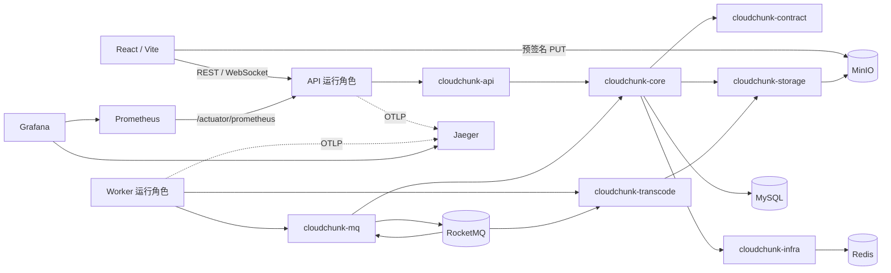
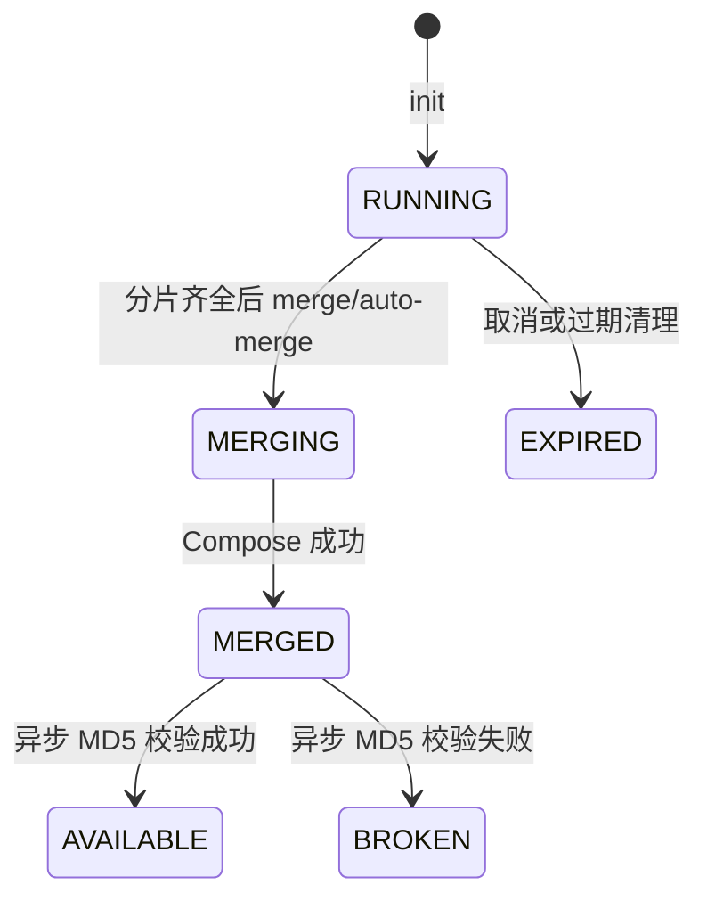

# CloudChunk 整体架构

CloudChunk 采用 Maven 多模块后端与独立 React 前端。模块依赖保持单向：接口层编排业务，业务层依赖存储、缓存与消息抽象，启动模块只负责装配。

## 运行时视图

- 浏览器优先经预签名 URL 直接写入 MinIO；失败时可退回后端代理上传。
- 后端 REST 接口由 `cloudchunk-api` 提供，业务状态位于 MySQL，短期进度、会话辅助数据、限流与缓存位于 Redis。
- 合并完成后投递校验消息，校验成功才投递媒体处理消息。
- `cloudchunk-boot` 是唯一 Spring Boot 启动模块；`api` 与 `worker` profile 使用同一制品、不同运行职责。Compose 的 `app` profile 可以同时启动 API、Worker 与前端。

## 模块职责

| 模块 | 职责 | 依赖边界 |
| --- | --- | --- |
| `cloudchunk-common` | 返回模型、异常、枚举、ID/MD5/MIME/对象键工具、上下文 | 不依赖业务模块 |
| `cloudchunk-infra` | Redis、Outbox/Inbox、对象 GC 持久化适配与异步追踪桥接 | 只依赖 common/contract，不反向依赖业务 |
| `cloudchunk-storage` | `StorageStrategy`、MinIO 与本地存储实现、预签名/合并/范围读取 | 不认识 HTTP 或业务用户 |
| `cloudchunk-mq` | Outbox 到 RocketMQ 的发布适配与校验消费者入口 | 适配消息系统，业务校验委托给 core |
| `cloudchunk-core` | 上传、文件、下载、网盘、分享、配额、认证、邮件、管理与缓存 | 业务规则；通过 contract 发布事件，不依赖 MQ/API/转码适配器 |
| `cloudchunk-transcode` | RocketMQ 消费者、图片缩略图、视频封面、文档提取 | 消费 `core` 已产生的文件状态 |
| `cloudchunk-api` | Controller、过滤器、异常映射、WebSocket 鉴权与进度处理器 | 调用核心业务，不持有业务状态 |
| `cloudchunk-boot` | 应用启动、`application.yml` 与日志配置 | 装配上述模块 |
| `cloudchunk-benchmark` | JMH 微基准 | 不参与应用运行 |
| `cloudchunk-web` | 登录、上传、文件/网盘/管理 UI 与 API 调用 | 独立 npm 工程 |

## 主要数据模型

| 模型 | 作用 |
| --- | --- |
| `file_meta` | 物理对象：MD5、对象键、大小、MIME、文件状态和处理结果 |
| `upload_session` | 上传会话：分片计划、会话状态、过期时间与合并状态 |
| `chunk_record` | 已确认分片：索引、MD5、对象键与状态 |
| `file_reference` | 用户参与上传或引用物理文件的关系 |
| `user_file` | 用户目录树中的节点；文件访问和预览以它作为所有权边界 |
| `user_quota` | 用户已预留/已使用空间和文件数 |
| `file_share` | 分享根节点、过期时间、提取码哈希与状态 |
| `transcode_record` | 图片、视频、文档处理任务状态与产物 |
| `email_verification` | 邮箱验证码、用途、失效与消费状态 |
| `system_setting` | 管理端允许维护的运行参数 |

`op_log` 由 `OperationAuditFilter` 写入，记录经认证写操作的区域、路径、结果与耗时；认证载荷和高吞吐分片接口明确排除，避免敏感信息或日志洪泛。

## 核心状态流

### 上传到可用

- `RUNNING` 会话可返回 `RESUME`，并从 Redis、MySQL 与对象存储重建已完成分片。
- 当 `cloudchunk.upload.auto-merge=true` 时，`chunk` 或 `confirm` 发现全部分片到齐会尝试合并；前端随后调用 `/merge/{fileId}` 仍安全，因为合并是幂等的。
- 文件只有 `AVAILABLE` 且调用者拥有活跃 `user_file` 节点时才能走常规下载与预览路径。

### 数据流总表

| 链路 | 输入 | 关键业务 | 持久化/外部系统 |
| --- | --- | --- | --- |
| 上传初始化 | 文件名、大小、MD5、分片计划 | 秒传、加入共享会话或新建会话；预留配额 | MySQL、Redis |
| 代理分片 | multipart 或二进制流 | 流式 MD5、写分片、记录进度 | MinIO、MySQL、Redis |
| 预签名分片 | 分片索引 | 生成 PUT URL；后续 `confirm` 检查对象 | MinIO、MySQL、Redis |
| 合并 | 文件 ID | Compose、写文件元数据、投递校验 | MinIO、MySQL、RocketMQ |
| 校验与处理 | 校验消息 | MD5 校验、缩略图/封面/文本提取 | MinIO、MySQL、RocketMQ |
| 下载 | 用户文件或文件 ID | 活跃引用鉴权、预签名或 Range 流 | MinIO、Redis、Caffeine |
| 网盘与分享 | 用户目录节点 | 目录树、回收站、ZIP、公开分享、转存 | MySQL、MinIO |

## 可配置运行边界

以下默认值位于 `cloudchunk-boot/src/main/resources/application.yml`：

| 配置 | 默认值 | 用途 |
| --- | --- | --- |
| `cloudchunk.chunk.default-size` | 10 MB | 后端默认分片协议 |
| `cloudchunk.chunk.min-size/max-size` | 1 MB / 200 MB | 分片合法范围 |
| `cloudchunk.chunk.session-ttl` | 24 小时 | 上传会话有效期 |
| `cloudchunk.upload.auto-merge` | `true` | 分片齐全后自动触发合并 |
| `cloudchunk.storage.type` | `minio` | 当前存储策略 |
| `cloudchunk.storage.presign-ttl` | 30 分钟 | 下载/上传预签名时长 |
| `cloudchunk.rate-limit.*` | 上传 30/60，下载 50/100 | 令牌桶速率/突发容量 |
| `cloudchunk.auth.token-ttl` | 7 天 | Redis 会话 TTL |

## 当前实现边界

- 存储：`minio` 与 `local` 可用；`StorageType.OSS` 只是扩展预留。
- 视频：使用 FFmpeg 抽取首帧封面，不进行完整视频转码或 H.264 重新编码。
- WebSocket：后端路径为 `/ws/upload/{fileId}`，含 token、Origin 和文件引用校验；前端已用于实时上传进度，并保留本地进度兜底。进度经 Redis channel 扇出到全部 API 节点，因此连接与分片确认请求落在不同节点时仍能推送。
- 可观测性：Actuator、Prometheus、Grafana 与 Jaeger 已形成可直接启动的 `observability` profile；HTTP、业务方法、Outbox 发布和 RocketMQ 消费使用同一 Trace ID。详见 [可观测性与链路追踪](./10-observability.md)。
