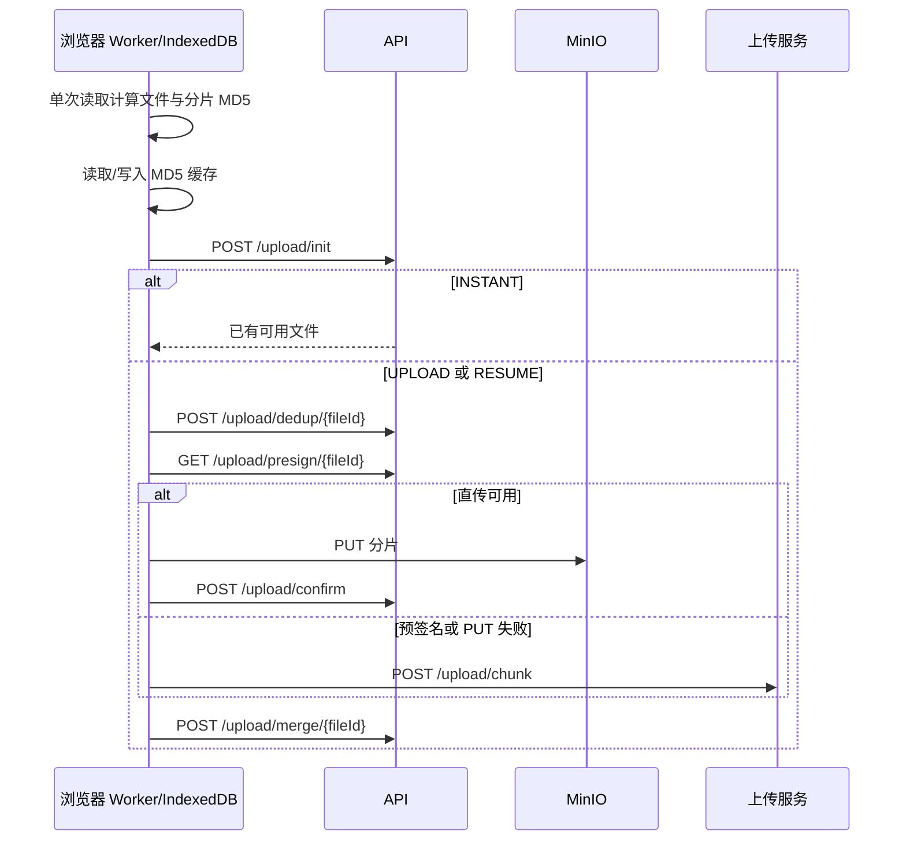
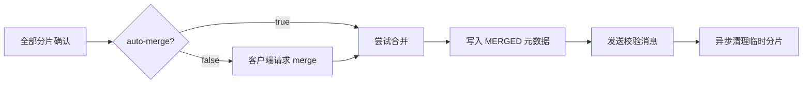

# 分片上传流程

本章描述当前 Web 客户端与 `/api/v1/upload` 的实际交互。上传协议由后端校验；浏览器会基于文件大小动态选择分片大小，因此前端请求中的 `chunkSize` 不一定等于后端配置的默认 10 MB。

## 入口与接口

| 阶段 | 接口 | 作用 |
| --- | --- | --- |
| 初始化 | `POST /api/v1/upload/init` | 校验分片计划，秒传、恢复/加入会话或创建新会话 |
| 查询进度 | `GET /api/v1/upload/progress/{fileId}` | 返回已完成分片 |
| 获取直传地址 | `GET /api/v1/upload/presign/{fileId}` | 为一批分片生成 MinIO PUT 预签名 URL |
| 确认直传分片 | `POST /api/v1/upload/confirm` | 检查 MinIO 对象，写分片记录和进度 |
| 代理上传分片 | `POST /api/v1/upload/chunk` | 接收 multipart 或二进制分片，后端流式写入存储 |
| 分片去重 | `POST /api/v1/upload/dedup/{fileId}` | 命中已存在分片时由存储服务端复制 |
| 合并 | `POST /api/v1/upload/merge/{fileId}` | 幂等地合并已完成分片 |
| 取消会话 | `DELETE /api/v1/upload/{fileId}` | 取消会话并释放相应预留 |

接口字段以运行中的 OpenAPI 页面 `/swagger-ui.html` 和 Controller DTO 为准。

## 前端流程

`cloudchunk-web/src/lib/upload.ts` 以如下顺序运行：

### 本地哈希与状态

- MD5 在 Web Worker 中计算，主线程不会执行完整文件哈希。
- 同一次文件扫描同时计算整文件 MD5 和各分片 MD5。
- 哈希结果会缓存到 IndexedDB，重新选择相同文件时可跳过计算。
- 已完成分片状态会周期性写入 IndexedDB，但当前页面不会在冷启动后自动恢复上传任务；后端进度仍是续传的可信来源。
- `guessChunkSize` 按文件大小选择 5 MB、10 MB、20 MB 或 40 MB。后端仍会校验是否落在 `cloudchunk.chunk.min-size` 到 `max-size` 之间。

### 分片调度

上传初始并发为 3，当前实现会在 2 到 10 之间依据单片耗时调整；单片失败最多重试 3 次，延迟以 500 ms 为基数指数退避。预签名 URL 按批预取，任意预签名获取或 PUT 失败后，后续分片退回后端代理路径。

这是一条客户端调度策略，不是服务端吞吐保证。实际并发还受浏览器、网络、MinIO、后端限流和对象存储能力影响。

## 初始化决策

`UploadService.init` 校验以下信息：文件名、文件大小、文件 MD5、分片大小、分片总数和 MIME 类型。然后按内容和会话状态走三类结果：

| 返回模式 | 条件 | 后续行为 |
| --- | --- | --- |
| `INSTANT` | 找到状态为 `AVAILABLE` 的相同 MD5 物理文件 | 为当前用户建立引用/网盘条目并预留配额；不上传分片 |
| `RESUME` | 找到相同 MD5 和大小、仍可用的运行中会话 | 当前用户加入或恢复会话，只传缺失分片 |
| `UPLOAD` | 未命中上述条件 | 创建新会话、进度记录和用户引用 |

新上传、加入共享会话、秒传和分享转存都通过配额的原子条件更新预留空间。合并阶段不会再次累计配额；取消或过期才释放对应预留。

## 分片写入与进度

### 后端代理

代理上传支持 multipart 与 `application/octet-stream`。服务端以流式方式将分片写入存储，并在读流过程中计算 MD5；不会先将完整分片读入 JVM 堆。MD5 不一致时该分片不计入完成进度。

### 预签名直传

预签名路径将文件数据从浏览器直接写入 MinIO。浏览器成功 PUT 后必须调用 `confirm`：后端会检查对象存在、大小符合分片计划、内容与声明的 `chunkMd5` 一致，再写入 `chunk_record` 与 Redis 进度。仅拿到 URL 不表示分片已完成。

内容校验默认不产生额外流量：S3/MinIO 对单次 PUT 写入的对象，ETag 就是对象内容的 MD5，而预签名直传正是单次 PUT，因此比对 ETag 即可。只有 ETag 退化成不透明标识时（分段上传、服务端加密）才回源流式重算，该回退可用 `cloudchunk.upload.verify-direct-chunk-by-read` 关闭。

这道校验同时保护分片级去重：`chunk_record.chunk_md5` 是去重的检索键，如果直传路径允许客户端声明一个与实际内容不符的 MD5，后续其他上传就会按该 MD5 复制到错误内容。

### 分片级去重

对恢复场景中仍缺失的分片，客户端会提交索引到 MD5 的映射。若服务端发现同 MD5 的分片，会在对象存储内部复制它并标记当前会话进度。去重失败不会中断普通上传。

候选分片被限定在**仍进行中（`RUNNING` 且未过期）的会话**内。这不是优化而是正确性要求：会话一旦合并成功，它的 part 对象就被异步删除了，只剩 `chunk_record` 这条指向空对象的记录。合并和取消现在都会连同 part 对象一起删除对应的 `chunk_record`，让两者保持同一生命周期。

### Redis 进度

Redis 使用 `cc:upload:progress:{fileId}` 记录分片完成状态、总数和完成数。Lua 脚本在一次原子操作中完成：

1. 仅首次完成该索引时置位。
2. 仅首次置位时增加完成数。
3. 刷新进度键 TTL。

这保证重复 `confirm` 或重试分片不会重复计数。`chunk_record` 作为持久化恢复来源，存储中的分片对象作为最终存在性校验。

## 合并与自动合并

合并前，服务端确认会话仍可合并且分片已齐全。它使用存储策略的 compose 操作在对象存储侧组合临时分片，避免将完整文件回流到应用进程。

`cloudchunk.upload.auto-merge` 默认是 `true`，所以最后一个 `chunk` 或 `confirm` 可能已经触发合并。前端仍调用 `merge`，该请求应返回已完成结果或执行尚未完成的合并，不应产生第二个物理对象。

合并成功时会：

- 更新上传会话和 `file_meta`。
- 为参与会话的用户建立根目录文件条目。
- 投递整文件校验消息。
- 清除 Redis 进度并异步删除临时分片。

文件此时处于 `MERGED`，尚未可作为普通文件下载。异步 MD5 校验通过后才变为 `AVAILABLE`；详情见 [03 校验与媒体处理](./03-checksum-transcode-flow.md)。

## 失败与恢复边界

| 场景 | 当前行为 |
| --- | --- |
| 浏览器刷新或网络中断 | 再次选择同一文件并执行 `init`，服务端返回可恢复会话与已完成分片 |
| 预签名失败或跨域失败 | 前端降级到后端代理上传 |
| 重复上传同一分片 | Redis Lua 与数据库记录保持幂等 |
| Redis 进度丢失 | 初始化恢复路径从 MySQL 与对象存储重建 |
| 客户端手动取消 | 调用删除会话接口；预留随会话释放 |
| 会话过期 | 定时任务清理临时对象并释放预留 |
| 校验失败 | 文件标记为 `BROKEN` 并删除错误对象；没有自动重传协议 |

## 配置入口

| 配置 | 默认值 | 影响 |
| --- | --- | --- |
| `cloudchunk.chunk.default-size` | 10 MB | 后端默认协议分片大小 |
| `cloudchunk.chunk.min-size/max-size` | 1 MB / 200 MB | 允许范围 |
| `cloudchunk.chunk.session-ttl` | 24 小时 | 会话与进度有效期 |
| `cloudchunk.upload.auto-merge` | `true` | 分片齐全后的自动合并 |
| `cloudchunk.storage.presign-ttl` | 30 分钟 | 预签名 URL 有效期 |
| `cloudchunk.rate-limit.upload-chunk-*` | 30 rps / burst 60 | 每用户分片请求限流 |

进一步的会话复用、进度重建和分片去重见 [02 秒传与断点续传](./02-instant-resume-flow.md)。