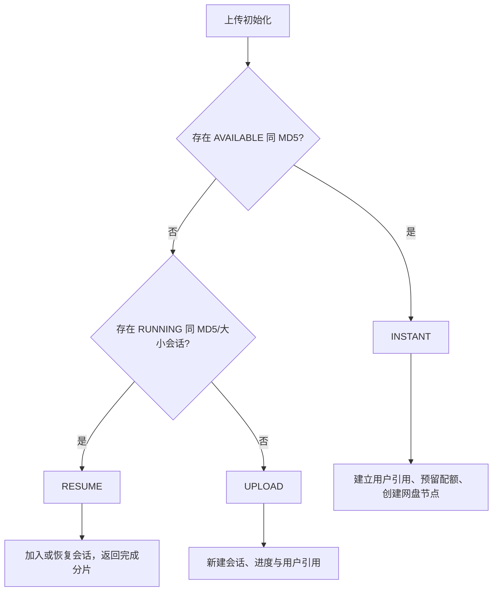
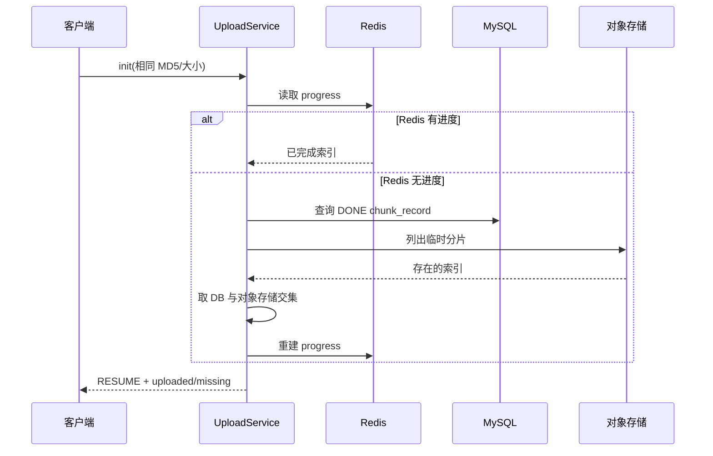

# 秒传、共享会话与断点续传

CloudChunk 以文件内容 MD5 为入口优化上传，但 MD5 命中并不意味着所有场景都会直接秒传。当前实现会区分可复用物理文件、运行中会话和新的上传请求，并把用户配额与逻辑文件节点一并处理。

## 三种初始化结果

`POST /api/v1/upload/init` 基于文件 MD5、大小和状态返回 `INSTANT`、`RESUME` 或 `UPLOAD`。

| 模式 | 条件 | 结果 |
| --- | --- | --- |
| `INSTANT` | 找到相同 MD5 且状态为 `AVAILABLE` 的 `file_meta` | 用户获得引用和逻辑文件节点，不再传输分片 |
| `RESUME` | 找到相同 MD5 与文件大小、仍处于可恢复状态的上传会话 | 返回同一会话与已完成分片，可由多个用户参与 |
| `UPLOAD` | 没有可复用文件或会话 | 创建新的上传会话 |

秒传、加入会话和新建上传均会走 `QuotaService` 的原子预留逻辑。对于已经拥有该文件引用的用户，业务会避免重复计入配额。合并成功不会再次增加配额。

## 秒传的对象模型

秒传不是简单地返回一个 URL。物理文件和用户文件分开建模：

| 模型 | 责任 |
| --- | --- |
| `file_meta` | 物理对象的 MD5、对象键、MIME、大小和可用状态 |
| `file_reference` | 用户与物理文件之间的引用或上传参与关系 |
| `user_file` | 用户目录树中的可见节点 |
| `user_quota` | 当前用户已预留/已使用的空间和文件数 |

可复用文件命中后，服务会增加引用、预留空间并创建根目录 `user_file`。因此秒传用户仍然通过自己的目录节点访问文件，不会直接暴露另一个用户的节点或存储路径。

MD5 在这里是内容去重标识，不是安全校验或权限凭据。服务仅复用状态为 `AVAILABLE` 的物理对象；合并中、损坏或已删除文件不能用于秒传。

## 共享上传会话

当没有可用的完整文件，但已有同 MD5 和大小的运行中会话时，后续用户不必重复上传同一内容。服务以 `file_reference` 记录参与者，每位参与者单独预留配额；合并完成后会为全部参与者创建逻辑文件节点。

这条路径的价值是避免并发上传相同大文件时创建多套临时分片。它不等价于“所有同名文件共享”，匹配条件仍基于内容 MD5 与大小。

## 断点续传的可信来源

分片进度存在三层来源，查询和恢复时按成本从低到高使用：

| 层级 | 数据 | 作用 |
| --- | --- | --- |
| Redis | `cc:upload:progress:{fileId}` | 正常续传时快速读取已完成索引 |
| MySQL | `chunk_record` | Redis 丢失后的持久化分片记录 |
| 存储 | 临时分片对象列表 | 确认对象真实存在，作为最终兜底 |

恢复过程的核心是：MySQL 中完成的索引只有在对象存储中仍存在对应临时对象时才会被视为完成。确认后的索引会重新写入 Redis，后续请求回到快速路径。

## 分片级去重

客户端在恢复/共享会话中会把仍缺失的分片 MD5 提交到 `/api/v1/upload/dedup/{fileId}`。服务端寻找其他完成分片；命中后通过存储策略内部复制临时对象，并将当前会话该索引标为完成。

- 复制发生在对象存储侧，文件内容不经过浏览器或应用进程。
- 该优化只减少命中分片的传输；未命中或去重失败时客户端正常上传。
- 分片级去重不同于整文件秒传：前者允许只复用部分内容。

## 前端 IndexedDB 的作用与边界

前端会写入两类 IndexedDB 数据：

- 文件与分片 MD5 缓存，用于再次选择相同文件时跳过重复哈希。
- 上传过程快照，用于保留 `fileId`、分片计划和局部进度。

当前页面没有读取快照并自动恢复任务的完整流程。用户需要重新选择同一文件触发 `init`，后端根据上述三层来源返回可信进度。不要将 IndexedDB 快照描述为已经实现“打开页面后自动续传”。

## 失败与一致性边界

| 场景 | 处理 |
| --- | --- |
| 重复分片上传 | Redis Lua 仅首次索引计数，数据库记录保持幂等 |
| Redis 重启或过期 | 由 MySQL 与对象存储重建进度 |
| 临时对象缺失 | 该索引重新进入 `missing`，客户端重传 |
| 会话取消/过期 | 临时对象、引用和配额预留由取消/清理逻辑处理 |
| 合并后校验失败 | 标记 `BROKEN` 并删除错误对象，不自动要求浏览器重传 |
| MD5 碰撞风险 | 当前去重协议以 MD5 为内容键；如业务需要抗碰撞保证，应演进为更强哈希或联合校验字段 |

完整分片、合并和自动合并行为见 [01 分片上传](./01-upload-flow.md)；配额和逻辑文件生命周期见 [06 网盘、分享与配额](./06-drive-share-quota-flow.md)。