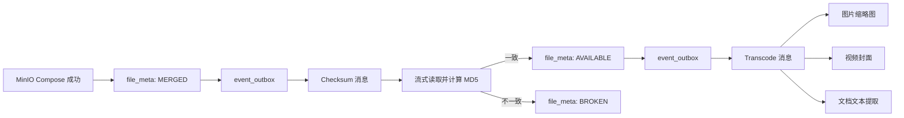

# 校验与媒体处理

合并完成并不表示文件已经可供普通下载。CloudChunk 先把物理对象置为 `MERGED`，随后通过 RocketMQ 异步校验整文件 MD5；校验通过后才变为 `AVAILABLE`，并投递媒体处理任务。

## 状态与消息链路

`ChecksumRequested`、`TranscodeRequested` 等稳定契约位于 `cloudchunk-contract`。业务事务只写 Outbox；`cloudchunk-mq` 的 Worker 负责投递 RocketMQ 并消费校验事件，媒体消费者位于 `cloudchunk-transcode`。

## 整文件 MD5 校验

合并成功后，服务端从存储策略读取完整对象并以流式方式计算 MD5。该过程不会将完整文件一次性读入 JVM 堆。

| 结果 | 文件状态 | 后续动作 |
| --- | --- | --- |
| 实际 MD5 与初始化 MD5 相同 | `AVAILABLE` | 投递媒体处理消息 |
| MD5 不一致 | `BROKEN` | 写损坏事件并把错误对象加入持久化 GC 队列 |
| 找不到元数据或已可用 | 不重复处理 | 校验消费者幂等返回 |

状态流转和对象回收都在发布端的同一个事务里完成，因此 `BlobBroken` 消息本身只承担告警职责：`BrokenBlobConsumer`（消费者组 `CG-broken-notify`）经 Inbox 幂等后输出结构化错误日志，并按归类后的原因累加 `cloudchunk_blob_broken_total` 指标，供 Prometheus 告警使用。原始 reason 里可能带 MD5 等高基数内容，不会直接作为指标标签。

当前协议没有自动要求浏览器重传文件的机制。用户重新上传同一内容时会重新走初始化和会话决策。

## 为什么异步

MinIO Compose 只负责在对象存储内拼接分片。整文件校验仍需要读取整个对象，图片处理、视频封面和文档解析也可能耗时较长。将它们从 `merge` 请求剥离可以避免把对象读取与外部工具执行放在用户的 HTTP 请求中。

这不代表合并接口的任何固定延迟承诺。实际耗时取决于对象大小、存储网络、队列积压、CPU、FFmpeg 和文档格式。

## 媒体处理类型

| MIME 类别 | 当前消费者 | 当前产物/行为 | 说明 |
| --- | --- | --- | --- |
| 图片 | `ImageTranscodeConsumer` | 多尺寸缩略图 | 使用 Thumbnailator，尺寸来自 `cloudchunk.transcode.image.sizes` |
| 视频 | `VideoTranscodeConsumer` | 首帧封面 | 使用 FFmpeg 抽帧；当前不进行 H.264 重新编码或完整视频转码 |
| 文档 | `DocTranscodeConsumer` | 文本信息提取 | 使用 Apache Tika |

处理记录通过 `transcode_record` 与文件元数据关联。前端文件详情会读取预览与处理状态，但并不保证每种 MIME 都有可展示产物。

## 幂等、重试与补偿

媒体消费者继承公共处理流程：领取 Inbox、创建带事件幂等键的任务记录、调用类别实现、保存结果或失败状态。消息消费者的重试由 RocketMQ 配置与消费结果驱动；失败处理还受到以下机制补充：

- `event_outbox` 通过领取、失败退避和陈旧锁回收保证至少一次投递。
- `event_inbox` 与 `(event_id, task_type)` 唯一键阻止重复消费产生重复副作用。
- 校验与转码补偿任务只补写 Outbox，不在业务事务中直连 MQ。
- 转码失败会写入失败状态，管理端和 API 可查询并通过 `POST /api/v1/transcode/{fileId}/retry` 请求重试。
- 图片、视频和文档分别使用独立的死信消费者组，避免一个组错误订阅其他类别的 DLQ。

## API 与前端覆盖

| 接口 | 行为 | 当前 Web 覆盖 |
| --- | --- | --- |
| `GET /api/v1/transcode/{fileId}` | 查询文件的媒体处理状态 | 通过文件详情/预览间接展示 |
| `POST /api/v1/transcode/{fileId}/retry` | 请求重新处理 | 当前页面未提供完整操作入口 |
| `GET /api/v1/file/{fileId}/thumbnail` | 获取缩略图 | 已用于文件展示 |
| `GET /api/v1/preview/{userFileId}` | 以用户文件节点获取预览信息 | 已接入文件详情 |

## 相关配置

| 配置 | 默认值 | 含义 |
| --- | --- | --- |
| `cloudchunk.transcode.ffmpeg-path` | `ffmpeg` | FFmpeg 可执行文件路径 |
| `cloudchunk.transcode.video-task-timeout` | 30 分钟 | 视频封面任务超时边界 |
| `cloudchunk.transcode.video-max-duration-seconds` | 7200 | 视频处理允许的最大时长 |
| `cloudchunk.transcode.image.sizes` | 200、600、1200 | 图片缩略图尺寸 |
| `cloudchunk.transcode.image.quality` | 0.85 | 图片输出质量 |

生产环境应确保队列、FFmpeg 可执行文件和对象存储访问均可用。若不需要媒体处理，应在部署设计中明确禁用或隔离对应消费者，而不是将 `MERGED` 文件直接当作 `AVAILABLE` 文件使用。

下载与预览的访问条件见 [04 下载与缓存](./04-download-flow.md)。
