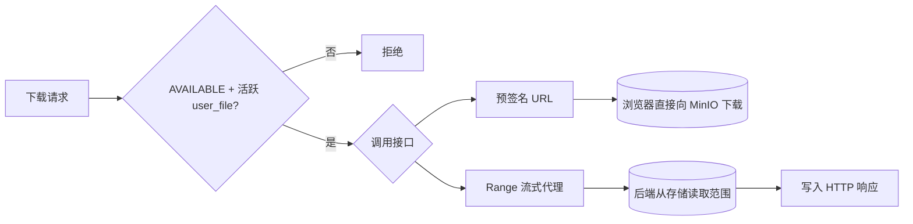
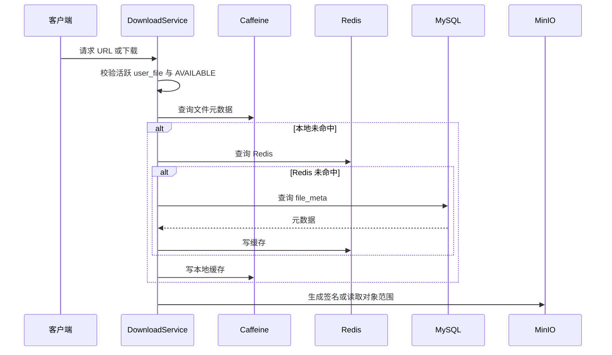

# 下载、预览与缓存

文件下载链路以“可用物理文件 + 当前用户的活跃网盘节点”为访问边界。知道 `fileId` 本身不足以获取文件：常规用户请求还必须能够证明自己拥有未删除的 `user_file` 条目。

## 接口

| 接口 | 用途 | 访问边界 |
| --- | --- | --- |
| `GET /api/v1/file/{fileId}` | 文件元数据 | 当前用户对文件存在活跃引用 |
| `GET /api/v1/file/{fileId}/url` | 获取预签名下载 URL | `AVAILABLE` 文件且有活跃目录节点 |
| `GET /api/v1/file/{fileId}/download` | 后端 Range 流式下载 | 同上 |
| `GET /api/v1/file/{fileId}/thumbnail` | 获取缩略图 | 文件引用与缩略图产物权限校验 |
| `GET /api/v1/preview/{userFileId}` | 查询预览信息 | 使用 `user_file` 所有权校验 |
| `GET /api/v1/share/{shareId}/download` | 公开分享单文件下载 | 有效分享、提取码与分享子树约束 |

管理员下载走独立的 `/api/v1/admin/files/{fileId}/download` 路径，并由管理员过滤器鉴权。

## 两种下载路径

### 预签名 URL

`GET /file/{fileId}/url` 返回 MinIO 下载地址。后端不转发文件字节，适合普通浏览器下载和直接媒体加载。默认有效期为 `cloudchunk.storage.presign-ttl` 的 30 分钟。

为减少重复调用 MinIO 生成 URL，服务会缓存预签名结果。缓存剩余时间必须足以覆盖新请求的时长；缓存 TTL 也会比签名的有效期更短，避免返回即将过期的地址。

预签名 URL 本身是临时凭据。调用方不得在日志、异常响应、持久化记录或公开页面中长期保存它。

### Range 流式代理

`GET /file/{fileId}/download` 解析 `Range` 请求头并从存储策略请求完整流或指定字节范围：

- 无 `Range`：返回完整文件，状态为 `200`。
- 合法 `Range`：返回区间流，状态为 `206`，带 `Content-Range`。
- 非法范围：返回范围错误，不尝试读取对象。

该路径用于需要后端控制响应头、支持浏览器媒体拖动，或需要在数据流上施加下载字节速率限制的场景。它不是“更快”的下载方式；数据仍经应用进程转发。

## 下载限速与请求限流

两类限制独立存在：

| 机制 | 位置 | 默认值 | 限制对象 |
| --- | --- | --- | --- |
| HTTP 请求令牌桶 | `RateLimitFilter` | 下载 50 rps、burst 100 | 单用户请求频率 |
| 字节速率限制 | `DownloadService` / `RateLimitedInputStream` | 可由 `download_speed_limit` 管理设置修改 | 代理下载流的字节传输速率 |

请求令牌桶不等于带宽限速。前者防止单个用户高频创建下载请求，后者在代理路径读取流时限制传输速度。管理端修改 `download_speed_limit` 后会热更新当前服务实例的下载服务配置。

## 缓存

文件元数据使用本地 Caffeine 与 Redis 两级缓存；默认最大条目数为 20,000、TTL 为 5 分钟。缓存的目的是降低反复读取 `file_meta` 的成本，不替代数据库的权限判断。

当文件元数据、状态或处理结果改变时，服务通过 Redis Pub/Sub 主题 `cc:cache:invalidate:file_meta` 失效相关缓存。多实例订阅者接收消息后清理本地 Caffeine 项，随后请求将回源数据库和存储。

## 前端覆盖

当前 Web 前端覆盖文件列表、文件详情、缩略图/预览入口和普通下载。`cloudchunk-web/src/lib/download.ts` 负责浏览器侧下载处理；前端不会直接绕过 API 获取物理对象键。

目录 ZIP 下载和公开分享下载的后端接口已经实现，但当前页面没有完整的公开分享与目录打包用户流程。相关边界见 [06 网盘、分享与配额](./06-drive-share-quota-flow.md)。

## 失败边界

| 场景 | 当前处理 |
| --- | --- |
| 文件不是 `AVAILABLE` | 常规下载和预览拒绝 |
| 用户节点在回收站或已删除 | 不能通过常规文件接口下载 |
| 预签名 URL 过期 | 客户端重新请求 `/url` 获取新地址 |
| Range 不合法 | 返回范围错误，不读取对象 |
| 缓存过期或失效消息丢失 | TTL 到期或下一次更新后回源；缓存不应作为权限唯一来源 |
| 存储读取失败 | 由全局异常处理映射为业务错误；已开始流式响应时无法再可靠返回 JSON 错误 |

文件从合并到 `AVAILABLE` 的状态变化见 [03 校验与媒体处理](./03-checksum-transcode-flow.md)。