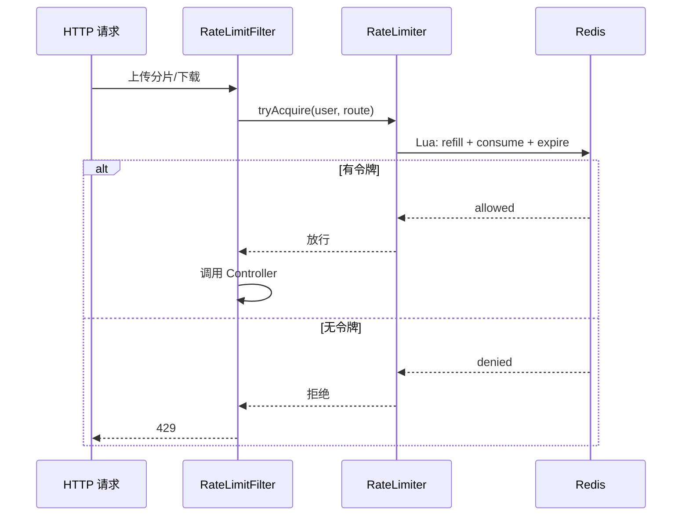
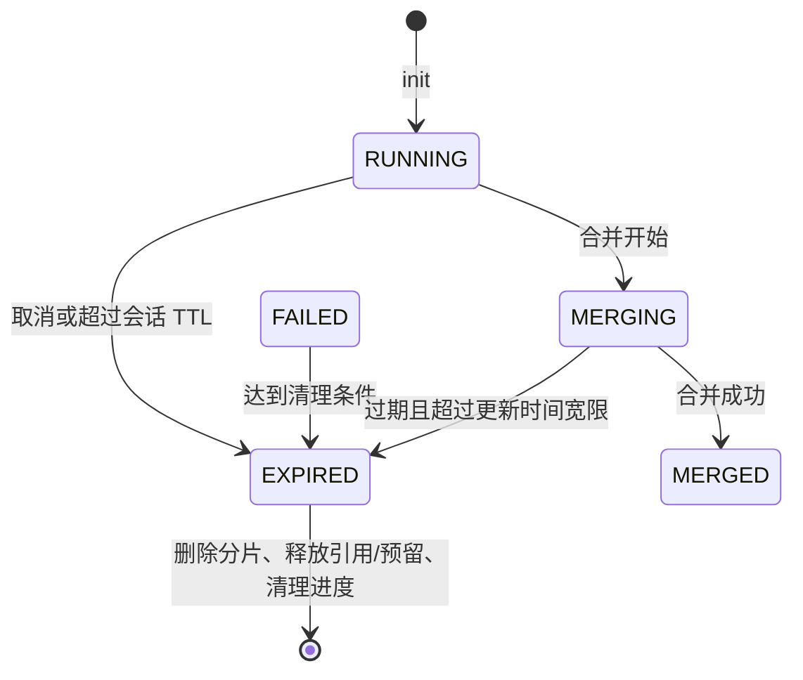

# 限流、过期清理与存储策略

本章说明上传与下载链路的横切保护：请求频率限制、过期上传会话回收，以及对象存储抽象。它们不改变业务 API 的语义，但决定系统在重试、长期运行和外部依赖异常时的资源边界。

## Redis Lua 令牌桶

`RateLimitFilter` 在需要限制的 HTTP 请求进入业务 Controller 前执行。当前配置默认开启，按用户维度为上传分片和下载请求使用 Redis 令牌桶。

| 场景 | 默认速率 | 默认突发容量 | 配置 |
| --- | --- | --- | --- |
| 上传分片 | 30 requests/s | 60 | `cloudchunk.rate-limit.upload-chunk-rps/burst` |
| 文件下载 | 50 requests/s | 100 | `cloudchunk.rate-limit.download-rps/burst` |
| 公开分享访问 | 1 request/s | 5 | 分享服务的独立限制 |

令牌桶允许短时突发：空闲期间令牌会补充到容量上限；请求到达时有令牌即放行，无令牌即返回限流响应。它限制的是请求速率，不是上传或下载的字节带宽。

### 为什么使用 Lua

一次获取令牌包含读取桶状态、按时间补充令牌、判断/扣减令牌、更新状态和设置过期时间。若把这些操作拆成多条 Redis 命令，并发请求可能都读取到同一份余额而被错误放行。

Lua 脚本让这组读改写在 Redis 内原子执行，并可只做一次客户端往返。典型状态包括当前令牌数与上次更新时间；键会在足够长的空闲时间后自动过期。

未登录请求不会以匿名默认用户绕过用户级限制；需要认证的路由仍由认证过滤器处理。

## 下载字节限速不是令牌桶

`RateLimitedInputStream` 由下载服务在代理下载路径上使用。它按读取字节节奏限制响应流，适合管理员通过 `download_speed_limit` 对代理下载带宽进行运行时治理。

| 机制 | 保护对象 | 修改位置 |
| --- | --- | --- |
| HTTP 令牌桶 | 单用户请求数量 | `cloudchunk.rate-limit.*` |
| `RateLimitedInputStream` | 代理下载的数据传输速率 | 管理端 `download_speed_limit` 设置 |

预签名直传下载的数据直接由 MinIO 输出，不经过应用响应流，因此不能依赖应用层字节限速控制。

## 上传会话状态与清理

上传会话由 `upload_session`、`chunk_record`、Redis 进度键和对象存储临时分片共同构成。定时清理的目标是回收不再可恢复的会话及其预留资源，而不是删除仍在活跃上传的用户数据。

当前清理策略包括：

- 周期：`StaleSessionCleanupTask` 约每小时运行。
- 目标：超期的 `RUNNING`、`FAILED` 会话，以及长时间未更新且超过宽限期的 `MERGING` 会话。
- 顺序：清理临时分片；以条件更新将会话转为 `EXPIRED`；只有状态转换成功的执行者才释放引用、配额预留和 Redis 进度。
- 幂等性：状态条件更新避免多个实例或多次扫描对同一会话重复释放配额。

合并成功的会话不应由该任务当作僵尸上传删除；后续校验和媒体处理有自己的状态与补偿路径。

## 存储策略

`cloudchunk-storage` 通过 `StorageStrategy` 隔离对象存储差异。业务层通过统一的读、写、删除、复制、合并、范围读取和预签名能力调用当前策略。

| 策略 | 状态 | 说明 |
| --- | --- | --- |
| `minio` | 已实现 | 默认策略，支持分片对象、Compose、预签名 URL 与范围读取 |
| `local` | 已实现 | 将对象写入本地根目录，适合开发或单机环境 |
| `oss` | 扩展预留 | 枚举存在，但仓库中没有阿里云 OSS 策略实现 |

策略由 `cloudchunk.storage.type` 选择，默认 `minio`。MinIO 配置包含 endpoint、access key、secret key、bucket、region 与安全连接选项；本地策略使用 `cloudchunk.storage.local.root` 和 `base-url`。

### Compose 的批次边界

`cloudchunk.storage.compose-batch-size` 默认值为 1000。它为大量分片的服务端组合提供批处理边界；最终限制仍由实际 MinIO 版本、对象大小和部署配置决定。文档不将该值解释为单文件大小或吞吐承诺。

## 外部依赖异常

| 外部系统 | 失败影响 | 当前保护方向 |
| --- | --- | --- |
| Redis | 限流、临时进度、缓存和锁受影响 | 持久化分片记录与对象存储可用于续传重建；认证/业务仍按各服务的故障策略处理 |
| MinIO/本地存储 | 分片写入、合并、下载或预览失败 | 返回存储业务错误；不把未确认分片计为完成 |
| MySQL | 会话、引用、配额和状态无法更新 | 业务请求失败；不以 Redis 状态替代持久化状态 |
| RocketMQ | 校验/媒体处理投递延后 | 文件状态与补偿任务负责后续恢复，不能假定消息永远立即送达 |

## 运维检查

1. 确认 `cloudchunk.rate-limit.enabled` 是否符合当前环境容量。
2. 监控过期会话数量、临时对象数量和配额释放是否同步。
3. 本地策略只适合共享卷或单实例场景；多实例部署应选择共享对象存储。
4. 更换存储类型前验证预签名、范围读取、复制和 compose 是否都由目标策略实现。
5. 不把 `oss` 配置为生产存储类型，除非先提供并验证对应策略实现。