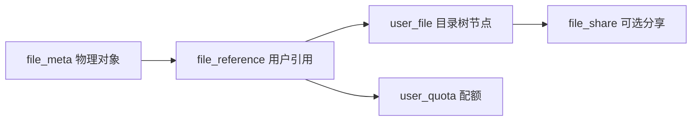
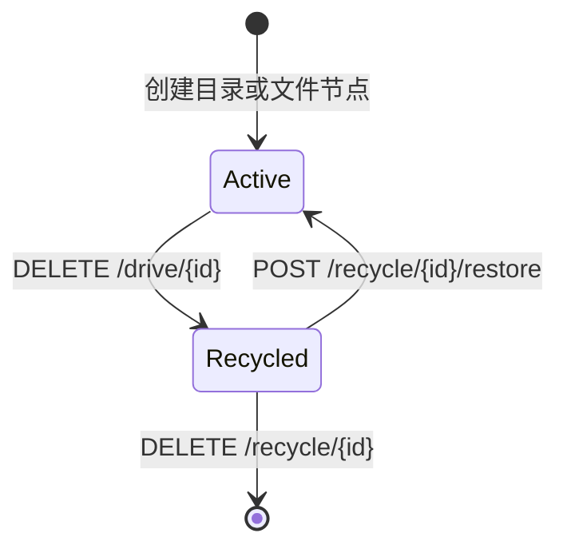
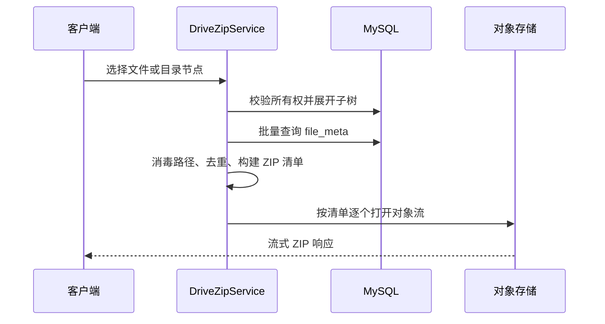
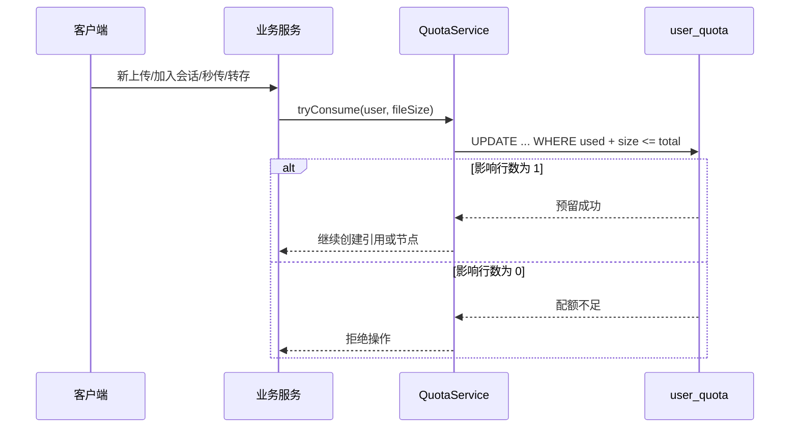

# 网盘、分享与配额

CloudChunk 将物理对象、用户引用和目录节点分开建模。这个边界使同一份内容可被多个用户引用，同时允许每个用户拥有独立的目录、回收站、分享和配额状态。

## 核心模型

| 模型 | 含义 | 关键约束 |
| --- | --- | --- |
| `file_meta` | 物理文件对象 | 一份对象可被多用户引用；状态决定是否可用 |
| `file_reference` | 用户对物理文件的引用或上传参与关系 | 用于引用计数、配额及文件访问 |
| `user_file` | 用户网盘树节点 | 文件访问、预览、移动和回收站均以节点为入口 |
| `user_quota` | 用户预留空间与文件数 | 用原子条件更新避免超额 |
| `file_share` | 某个网盘节点的公开分享 | 包含过期时间、状态和提取码哈希 |

## 网盘目录与文件节点

`/api/v1/drive` 提供目录创建、列表、重命名、移动、删除与 ZIP 打包接口；`/api/v1/recycle` 管理软删除节点。

| 操作 | 接口 | 结果 |
| --- | --- | --- |
| 新建目录 | `POST /drive/mkdir` | 在父节点下创建目录节点 |
| 列表 | `GET /drive/list` | 返回指定父节点下的活跃节点 |
| 重命名 | `POST /drive/rename` | 修改当前用户节点名称 |
| 移动 | `POST /drive/move` | 校验目标目录归属后调整父节点 |
| 移入回收站 | `DELETE /drive/{id}` | 将节点及其子树标记为回收站状态 |
| ZIP 下载 | `POST /drive/download-zip` | 解析文件/目录节点后流式输出 ZIP |
| 还原 | `POST /recycle/{id}/restore` | 还原节点及其子树 |
| 彻底删除 | `DELETE /recycle/{id}` | 删除引用，最后一个引用时回收物理对象 |

上传合并成功、秒传命中、共享会话完成和分享转存时，服务会为用户创建根目录文件节点。该操作是幂等的：同一用户、同一活跃文件不会因重试出现重复节点。

## 回收站状态

回收站是逻辑删除，不是配额规避机制。

- 删除目录时按子树处理，底层使用 MySQL 8 递归 CTE 获取节点集合。
- 移入回收站仍保留用户对物理文件的引用，因此**不释放配额**。
- 还原只恢复节点状态，同样不重新占用配额。
- 彻底删除才释放 `file_reference`；当最后一个引用消失时，服务删除对象并更新物理文件状态。
- 常规下载与预览要求活跃 `user_file` 节点，因此回收站中的文件不能通过普通文件接口继续访问。

## ZIP 打包

`POST /api/v1/drive/download-zip` 接收文件或目录节点 ID。服务先完成权限校验和压缩清单准备，再开始写 HTTP 响应体。

当前实现的保护边界包括：

- 在写响应前验证所有节点，避免已开始 ZIP 输出后才返回 JSON 权限错误。
- 对 ZIP 内路径进行消毒，防止 `../` 等 zip-slip 路径。
- 对同名条目重命名去重，目录遍历维护已访问集合。
- 条目上限为 20,000，目录遍历节点上限为 100,000。
- 单个对象在流式输出阶段读取失败时无法可靠改写响应状态；实现应记录异常并避免影响其余可读取条目。

当前 Web 页面尚未提供完整的目录 ZIP 操作入口，后端 API 可直接通过 OpenAPI 调用。

## 分享

分享由拥有者创建，公开浏览和下载不要求登录，但必须满足有效分享、提取码和子树边界。我的分享列表、创建与取消属于登录用户操作。

| 操作 | 接口 | 是否需要登录 |
| --- | --- | --- |
| 创建分享 | `POST /share` | 是 |
| 我的分享列表 | `GET /share/list` | 是 |
| 取消分享 | `DELETE /share/{shareId}` | 是 |
| 公开详情 | `GET /share/{shareId}` | 否，需要提取码 |
| 公开子节点 | `GET /share/{shareId}/children` | 否，需要提取码 |
| 公开下载 | `GET /share/{shareId}/download` | 否，需要提取码 |
| 公开 ZIP | `GET /share/{shareId}/download-zip` | 否，需要提取码 |
| 转存到我的网盘 | `POST /share/save` | 是 |

### 创建与验证

服务生成随机 `shareId` 和提取码。提取码只在创建结果中返回明文；数据库保存其哈希，校验时使用常量时间比较，同时兼容历史明文数据。

公开访问还会确认：

1. 分享未取消、未过期。
2. 提取码有效。
3. 请求的子节点仍在分享根目录子树内。
4. 公开访问令牌桶允许当前分享和客户端组合。

公开分享的默认频率限制是每秒 1 次、突发 5 次。它与已登录用户的上传/下载限流独立。

### 转存

接收者调用 `/share/save` 时，服务会校验分享有效、目标目录归属和非自分享，然后递归创建目录/文件节点。每个被转存的文件需要通过原子配额预留；事务失败时不应留下半截目录树或孤立引用。

当前 Web 前端有“我的分享”列表和管理操作，但未提供完整的公开分享浏览、公开下载和转存页面流程。

## 配额预留模型

配额的关键原则是“准入即预留”，而不是“所有分片合并后再扣减”。

| 时点 | 配额行为 |
| --- | --- |
| 新上传创建会话 | 预留空间和文件数 |
| 加入共享运行中会话 | 为参与者预留 |
| 秒传命中 | 为新增引用预留 |
| 分享转存 | 为接收者预留 |
| 合并成功 | 不重复累加 |
| 取消或过期会话 | 释放对应预留 |
| 移入/还原回收站 | 不改变预留 |
| 彻底删除最后引用 | 释放对应引用与配额 |

`UserQuotaMapper.tryAddUsed` 使用带条件的单条更新完成“检查加扣减”。这比先读剩余空间再更新更适合并发场景，因为 MySQL 会把条件检查与更新放在同一个原子操作中。

## 前端覆盖

| 功能 | 后端 | 当前 Web |
| --- | --- | --- |
| 文件/目录列表、创建、重命名、移动 | 已实现 | 已接入 |
| 回收站列表、恢复、彻底删除 | 已实现 | 已接入 |
| 配额查询 | 已实现 | 已接入 |
| 创建/列表/取消分享 | 已实现 | 已接入 |
| 公开分享浏览、下载、转存 | 已实现 | 未提供完整页面流程 |
| 目录 ZIP 下载 | 已实现 | 未接入 |

上传与共享会话如何建立用户节点见 [01 分片上传](./01-upload-flow.md) 和 [02 秒传、共享会话与断点续传](./02-instant-resume-flow.md)。