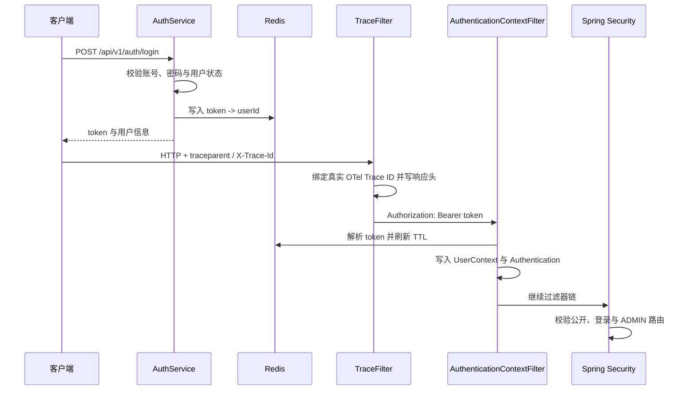

# 认证、管理、预览与可观测性

本章说明 CloudChunk 的访问控制与运行治理边界：Redis 会话、过滤器、邮箱验证码、管理员接口、文件预览、上传 WebSocket，以及 Actuator 与追踪配置。

## 请求认证链路

认证采用 Bearer Token 与 Redis 会话。登录成功后，服务端创建随机 token，并写入 `cc:auth:token:{token}`；默认 TTL 来自 `cloudchunk.auth.token-ttl`，当前为 7 天。



`TraceFilter` 只负责 Trace 关联与响应 `X-Trace-Id`；`AuthenticationContextFilter` 只负责 Bearer Token、Spring Security `SecurityContext` 和业务 `UserContext` 生命周期。`SecurityFilterChain` 显式声明公开路由、普通登录路由和 `/api/v1/admin/**` 的 `ADMIN` 角色要求。`RateLimitFilter` 独立执行上传分片和下载请求限流，不是专用登录限流器。

### 公开接口

以下 API 不要求 Bearer Token：

| 接口 | 说明 |
| --- | --- |
| `GET /api/v1/ping` | 服务连通性探测 |
| `POST /api/v1/auth/login` | 登录 |
| `POST /api/v1/auth/register` | 注册 |
| `POST /api/v1/auth/send-code` | 发送邮箱验证码 |
| `POST /api/v1/auth/reset-password` | 邮箱验证码找回密码 |
| `GET /api/v1/share/{shareId}...` | 公开分享读取、下载与 ZIP；仍需提取码 |

`GET /api/v1/share/list` 是“我的分享”接口，必须登录，不属于公开分享例外。

### 会话失效与失败保护

- `logout` 删除 Redis token，实现即时退出。
- token 解析时会检查用户是否仍启用；禁用用户的会话会被清理。
- 登录失败按照账号在 Redis 中记录计数，当前阈值为 10 次、窗口 15 分钟。
- Redis 登录失败计数不可用时不应把缓存异常扩大为登录服务整体不可用；认证失败仍按普通错误处理。

## 密码与邮箱验证

### 密码哈希

新密码使用 Argon2id；历史 PBKDF2 哈希仍可验证。用户以旧哈希登录成功后，服务会尝试透明升级为 Argon2id。密码始终保存为不可逆哈希，而不是可还原加密文本。

### 邮箱验证码

`POST /api/v1/auth/send-code` 支持 `register`、`reset` 和 `bind` 三类用途；验证码为 6 位数字，有效期 10 分钟。Redis 使用 `cc:email:rate:{type}:{email}` 在同一邮箱与用途下实施 60 秒发码间隔，并记录验证码校验失败次数。

| 用途 | 服务端 API | 当前实际边界 |
| --- | --- | --- |
| `register` | 可请求发送验证码 | 当前 `POST /auth/register` 的 DTO 不包含验证码字段，注册流程并未强制消费该验证码 |
| `reset` | `POST /auth/reset-password` | 必须提交有效验证码以重置密码 |
| `bind` | `POST /auth/change-email` | 登录后向新邮箱发送验证码，再提交换绑请求 |

本地未配置 SMTP 时，邮件发送行为依赖当前邮件实现与运行配置；部署前应在真实 SMTP 环境验证送达、失败重试和日志脱敏。

## 管理端

管理员 API 位于 `/api/v1/admin/**`，除登录外还需 Spring Security 的 `ROLE_ADMIN` 授权。管理员种子账号默认关闭，只有显式设置以下配置才会初始化：

```yaml
cloudchunk:
  admin:
    seed-enabled: true
    seed-username: admin
    seed-email: admin@example.com
    seed-password: change-me-before-production
```

生产环境不应使用示例密码，并应通过部署密钥管理提供真实配置。

| 能力 | 接口 | 当前 Web 覆盖 |
| --- | --- | --- |
| 查询用户 | `GET /admin/users` | 已接入 |
| 启用/禁用用户 | `POST /admin/users/{userId}/enable|disable` | 已接入 |
| 重置用户密码 | `POST /admin/users/{userId}/reset-password` | 后端已实现，页面未接入 |
| 调整用户角色 | `POST /admin/users/{userId}/role` | 后端已实现，页面未接入 |
| 分配空间 | `POST /admin/users/space` | 已接入 |
| 查询/删除文件 | `GET /admin/files`、`DELETE /admin/files/{fileId}` | 已接入 |
| 管理员下载 | `GET /admin/files/{fileId}/download` | 已接入 |
| 查询/设置运行参数 | `GET/POST /admin/settings` | 已接入 |

API 层会阻止管理员禁用自身或将自身降级。可写系统设置采用白名单，包含 `default_space_bytes`、`download_speed_limit`、`email_template_verify` 与 `email_template_reset`；其中 `download_speed_limit` 写入后会热更新下载服务。

`OperationAuditFilter` 会记录认证之外的低频写操作，并跳过上传分片、确认和分片去重等高吞吐路径。日志只保存操作类别、路由目标、用户、来源地址、User-Agent、结果和耗时，不保存请求体，避免密码、提取码等敏感参数进入 `op_log`。审计落库失败会记录应用错误日志，但不会覆盖原业务响应。

## 文件预览

`GET /api/v1/preview/{userFileId}` 以 `user_file` 作为入口，而非直接只接收物理 `fileId`。服务先校验节点归属与活跃状态，再聚合 MIME、媒体处理状态、缩略图和可下载信息。

该设计与下载链路一致：物理对象本身不代表用户有访问权。当前 Web 文件详情抽屉已经使用预览 API；不同 MIME 是否拥有可展示产物取决于校验和媒体处理结果。

## 上传 WebSocket

后端注册上传进度端点：

```text
/ws/upload/{fileId}
```

握手阶段会校验 token、Origin 白名单以及用户对文件的引用关系。允许来源由 `cloudchunk.websocket.allowed-origins` 配置，默认包含本地 Vite 和后端地址。

### 跨节点扇出

浏览器的 WebSocket 连接固定在某一个 API 节点上，而 `POST /upload/chunk`、`POST /upload/confirm` 会被负载均衡分到任意节点，两者未必是同一台。因此进度不是由业务代码直接推给连接的：

```text
confirm 请求落到节点 B
  → UploadProgressBroadcaster 发布到 Redis channel cc:ws:upload-progress
  → 所有节点的 UploadProgressHandler 收到信封
  → 只有持有该 fileId 连接的节点 A 真正推送
```

发布者自身也订阅该 channel，所以本地连接同样只收到一次消息，不存在重复推送。Redis 发布失败时退回本地直推：单节点部署仍然完整可用，多节点则退化为可能丢推送——进度推送是尽力而为的辅助信号，前端另有 IndexedDB 本地进度兜底，任何推送失败都不影响上传本身。

如果去掉这个扇出，多节点部署下 WebSocket 会静默地收不到进度：不报错，只是不工作。

## 运行可观测性

### Actuator 与指标

默认暴露的 Actuator 端点包括：

| 路径 | 用途 |
| --- | --- |
| `/actuator/health` | 健康状态（公开） |
| `/actuator/info` | 应用信息（管理员） |
| `/actuator/metrics` | Micrometer 指标索引（管理员） |
| `/actuator/caches` | 缓存信息（管理员） |
| `/actuator/prometheus` | Prometheus 格式指标；默认管理员，受信网络可用 `PROMETHEUS_PUBLIC=true` 开放抓取 |

`management.metrics.distribution.percentiles-histogram.http.server.requests=true` 启用 HTTP 请求直方图，便于由 Prometheus/Grafana 在采集端计算分位数。`observability` Compose profile 已提供 Prometheus、Grafana 预置数据源和 CloudChunk 总览面板。

关键业务计数器包括 `cloudchunk.outbox.published`、`cloudchunk.outbox.publish_failures`、`cloudchunk.object_gc.completed`、`cloudchunk.object_gc.failures` 与 `cloudchunk.rate_limit.rejected`，可用于设置事件堆积、持久化删除失败和限流异常告警。

### Trace 与 OTLP

日志格式同时包含 `%X{traceId}` 与 `%X{spanId}`。存在 Micrometer Span 时，`TraceFilter` 使用真实 OTel Trace ID；Outbox 事件携带 Trace/Parent Span 上下文，Publisher 与 Consumer 会创建同一链路下的消息 Span。

运行配置提供以下追踪相关键：

| 配置 | 默认值 | 含义 |
| --- | --- | --- |
| `management.tracing.sampling.probability` | `0.0` | 默认不采样 |
| `management.otlp.tracing.endpoint` | `http://localhost:4318/v1/traces` | OTLP trace 接收端 |
| `TRACING_SAMPLING` | 可覆盖 | 设置为非零采样率后才会尝试导出 |
| `OTLP_TRACES_ENDPOINT` | 可覆盖 | 覆盖 OTLP trace 接收端 |

`docker compose --profile observability ...` 可启动 Jaeger OTLP Collector 与查询 UI；完整拓扑、指标和验收方式见 [可观测性与链路追踪](./10-observability.md)。

## 部署检查

1. 在反向代理环境确认 `Authorization`、`X-Trace-Id`、WebSocket Upgrade 和 Origin 能正确透传。
2. 限制 Actuator 端点的外部访问；尤其不要将健康细节、缓存或 Prometheus 指标无保护暴露到公网。
3. 显式配置管理员种子账号，或使用首次部署运维流程创建管理员；不要依赖默认凭据。
4. 为 Redis 设置可用性监控，因为会话、验证码限流、缓存和上传进度均依赖它。
5. 若启用 OTLP，验证 collector 地址、采样率、超时和敏感字段脱敏。
