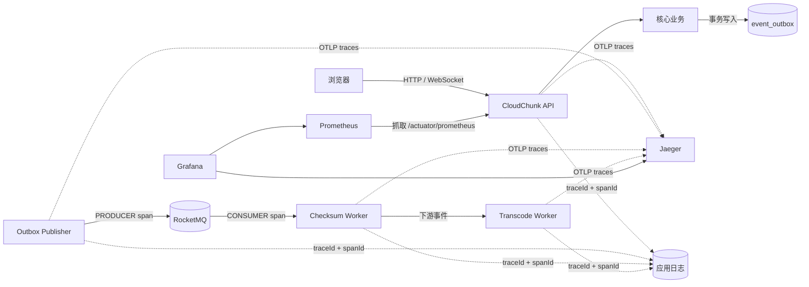
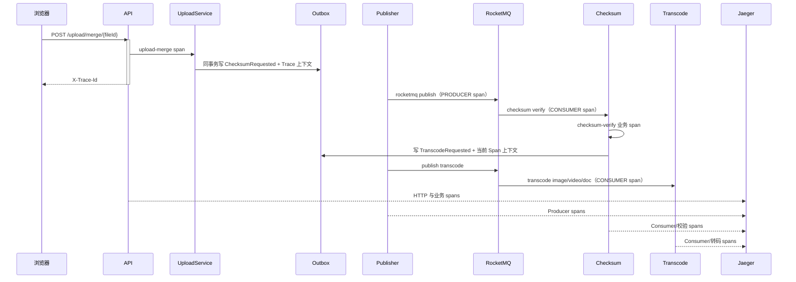

# 可观测性与链路追踪

CloudChunk 的观测面由三部分组成：Micrometer/Prometheus 指标、带 Trace/Span ID 的关联日志、Jaeger 分布式链路。`deploy/docker-compose.yml` 的 `observability` profile 可直接启动 Prometheus、Grafana 和 Jaeger。

## 观测拓扑



## 上传异步链路



事件负载包含 `traceId`、`parentSpanId` 和 `traceSampled`。这不是业务字段，而是跨事务 Outbox 和消息代理边界的 W3C 等价上下文。旧事件缺少 Span 信息时仍可消费，只会作为新的根链路显示。

## 关键指标

| 指标 | 含义 |
| --- | --- |
| `http_server_requests_seconds_*` | HTTP 吞吐、状态码与延迟直方图 |
| `cloudchunk_upload_init_seconds_*` | 上传初始化、秒传与续传决策耗时 |
| `cloudchunk_upload_chunk_seconds_*` | 后端代理分片耗时 |
| `cloudchunk_upload_merge_seconds_*` | 对象合并耗时 |
| `cloudchunk_checksum_verify_seconds_*` | 整文件 MD5 校验耗时 |
| `cloudchunk_blob_broken_total{reason}` | 整文件校验失败并置为 `BROKEN` 的文件数，按原因归类 |
| `cloudchunk_outbox_published_total` | RocketMQ 已确认发布事件数 |
| `cloudchunk_outbox_publish_failures_total` | Outbox 发布失败与重试次数 |
| `cloudchunk_rate_limit_rejected_total` | 上传/下载限流拒绝数 |
| `cloudchunk_object_gc_*` | 对象 GC 成功与失败数 |
| `cache_gets_total{cache="fileMeta"}` | 文件元数据 L1 缓存命中/未命中 |

Grafana 会自动加载“CloudChunk 运行总览”，包括请求速率、P95、5xx、Outbox 与缓存命中率。Jaeger 数据源也已预置，可从同一 Grafana 实例检索 Trace。

## 本地启动

先启动观测栈：

```powershell
docker compose --profile observability -f deploy/docker-compose.yml --env-file deploy/.env up -d jaeger prometheus grafana
```

本地运行后端时开启采样和 Prometheus 抓取：

```powershell
java -jar cloudchunk-boot/target/cloudchunk-boot.jar --spring.profiles.active=dev,observability
```

访问地址：

| 页面 | 地址 |
| --- | --- |
| Grafana | `http://localhost:3000` |
| Jaeger | `http://localhost:16686` |
| Prometheus | `http://localhost:9090` |
| 原始 Prometheus 指标 | `http://localhost:8080/actuator/prometheus` |

## 安全与生产建议

- `TRACING_SAMPLING` 默认是 `0.0`，开发验收可设为 `1.0`；生产环境建议从 `0.01` 起，根据流量和存储成本调整。
- `PROMETHEUS_PUBLIC` 默认关闭。生产环境只应在管理网络、Sidecar 或网关白名单后开启。
- Trace 标签不记录 Token、提取码、文件内容、邮箱验证码或对象存储临时签名。
- 日志格式为 `trace=<traceId> span=<spanId>`；Trace ID 与 Jaeger 页面完全一致。
